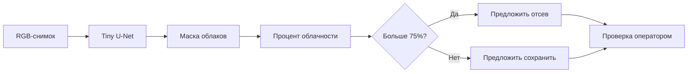

# CloudVision AI

**Анализ облачности спутниковых снимков · SK Kids Challenge 2026 · СПУТНИКС**

Исследовательский прототип на Python и PyTorch: компактная **Tiny U-Net** строит бинарную маску облаков, вычисляет долю облачности и предлагает оператору решение по порогу **строго >75%**. Исходные снимки автоматически не удаляются.

> **Статус:** работающая GPU/CPU-пакетная обработка и операторский просмотр. Надёжность автоматического отсева сильно облачных снимков **не подтверждена**; необходим контроль человека.

## Возможности

- Сегментация облаков на RGB-снимке и вычисление процента облачности по бинарной маске.
- Правило: **>75% → предложить отсев; ≤75% → сохранить**.
- Обработка папок снимков с CUDA или CPU, учёт прогресса в SQLite, безопасный повторный запуск.
- HTML-галерея оригиналов и розовых масок для проверки оператором.
- Раздельные протоколы TRAIN, VAL, независимого TEST и специально отобранных сложных сцен.

## Алгоритм



**Облачность (%) = 100 × количество облачных пикселей / количество всех пикселей изображения.**

## Результаты и ограничения

| Исследование | Измеренные результаты | Что можно заключить |
|---|---|---|
| VAL, 10 кадров | MAE: v4 **3,455 п.п.**, v5 **3,316 п.п.** | VAL использовалась для выбора эпох и не является независимой оценкой |
| Независимый TEST, 24 кадра | MAE: v4 **16,63 п.п.**, v5 **16,43 п.п.**; обе **23/24** решений | **0/24** эталонов с облачностью >75%; этот TEST не подтверждает обнаружение снимков для отсева |
| Целевой cloud-heavy challenge, 13 сцен | **7** эталонных снимков >75%; обе модели обнаружили **3/7**, пропустили **4/7** | Сцены специально отбирались человеком: результат нельзя распространять на весь архив |

Разница MAE v4/v5 на независимом TEST всего **0,20 п.п.** и не доказывает превосходство v5. Дополнительно обе модели дали один ложный отсев на каждом из этих двух наборов. [Подробное объяснение результатов](docs/RESULTS_FOR_JURY.md).

**Данные:** исходный каталог — **4 207** фотографий; для v5 использовались **115 TRAIN** (61 исторический + 35 новых + 19 пилотных) и **10 VAL**. Это не означает наличие 4 207 размеченных масок.

## Запуск на Windows (пример)

Нужны **собственные RGB-снимки** и совместимый checkpoint Tiny U-Net: веса и исходные данные намеренно не размещены в этом публичном репозитории.

```powershell
py -3.11 -m venv .venv
.\.venv\Scripts\python.exe -m pip install -r requirements.txt
.\.venv\Scripts\python.exe -m pip install "numpy>=1.26,<3"
# Установите PyTorch согласно вашей версии CUDA/CPU: https://pytorch.org/get-started/locally/

.\.venv\Scripts\python.exe run_batch_v4.py --input data/new_raw --model models/cloudvision_unet_v4_policy.pt --device auto --out reports/demo --limit 10
.\.venv\Scripts\python.exe build_operator_report_v4.py --input data/new_raw --batch reports/demo
Start-Process .\reports\demo\operator_review\index.html
```

Запуск лёгких тестов без checkpoint:

```powershell
.\.venv\Scripts\python.exe -m unittest discover -s tests -p "test_batch_v4.py" -v
.\.venv\Scripts\python.exe -m unittest discover -s tests -p "test_rules.py" -v
```

## Структура

| Раздел | Исходники |
|---|---|
| Пакетный GPU/CPU запуск | `run_batch_v4.py`, `cloudvision/batch.py` |
| Модель и инференс | `train_cloudvision.py`, `cloudvision/inference.py` |
| Операторский просмотр | `build_operator_report_v4.py` |
| Ручная разметка | `label_with_ai_fast.py` |
| Замороженные оценки | `evaluate_v4_holdout.py`, `evaluate_v5_holdout.py` |
| Диагностика масок | `compare_cloud_heavy_models.py` |
| Методики и результаты | `docs/` |
| Тесты | `tests/` |

## Важные ограничения

Порог именно **строго >75%**: значение ровно 75% означает **«сохранить»**. Исходные фотографии автоматически не удаляются. Ранее использованные TEST не применяются для подбора модели или порога.

Модели `.pt`, исходные спутниковые фотографии, ручные PNG-маски, CSV/SQLite экспериментов и персональные данные **не опубликованы**. Для их распространения могут потребоваться отдельные права.

Публичная конкурсная версия основана на проекте [cloudvision-starter](https://github.com/Qllan/cloudvision-starter), ветка `feature/gpu-batch-resume` (снимок кода коммита `8bc84d3`). Этот репозиторий — **исходный код и документация**, а не сервис, работающий без обученных весов и данных.
